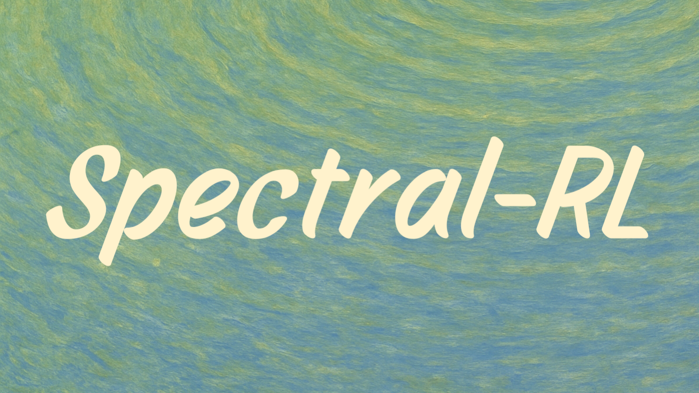
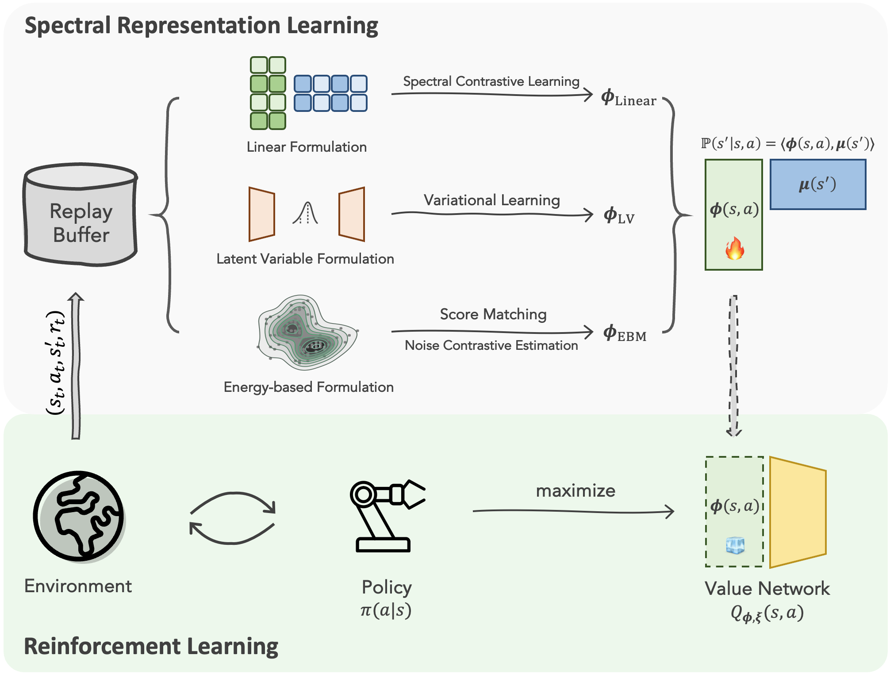

<p align="center">
  
</p>


# Spectral RL: Spectral Representations for Reinforcement Learning

[](https://www.python.org/downloads/) [](https://opensource.org/licenses/MIT) [](https://spectral-rl.github.io)



**Spectral-RL** is a comprehensive reinforcement learning library focused on leveraging the power of spectral representations for RL.

## 🎯 Key Features

- **State-of-the-art Algorithms**: Implementation of 4 major spectral representation learning methods;
- **Multi-environment Support**: Compatible with MuJoCo, DMControl, HumanoidBench, and MetaWorld tasks;
- **Modular Design**: Easy-to-use, extensible framework built on popular model-free RL algorithms;
- **Research-Ready**: Comprehensive evaluation tools and reproducible experiments.

## 📚 Supported Algorithms

| Algorithm | Paper |
|-----------|--------|
| **LVRep** | [Latent Variable Representation](https://arxiv.org/abs/2212.08765) |
| **CTRL** | [Contrastive Representation](https://arxiv.org/abs/2207.07150) |
| **μLVRep** | [Multi-step Latent Variable Representation](https://arxiv.org/abs/2311.12244) |
| **Speder** | [Spectral Decomposition Representation](https://arxiv.org/abs/2208.09515) |
| **Diff-SR** | [Diffusion Spectral Representation](https://arxiv.org/abs/2406.16121) |

## 🚀 Installation

### Prerequisites
- Python >= 3.7
- PyTorch >= 1.8.0
- CUDA (optional, for GPU acceleration)

### Quick Start
```bash
# Clone the repository
git clone https://github.com/spectral-rl/spectral-rl.git
cd spectral-rl

# Install in development mode
pip install -e .
```

### Optional: HumanoidBench
[HumanoidBench](https://github.com/carlosferrazza/humanoid-bench) pins `gymnasium==0.29.1` and `mujoco==3.1.6`, which conflict with the versions used here, but it runs fine on them, so install it without its dependencies:
```bash
git clone https://github.com/carlosferrazza/humanoid-bench && cd humanoid-bench
git checkout cb1189039151c8aadaaa987b442da54383c87fab
pip install --no-deps -e .   # editable: its sub-packages have no __init__.py
pip install "jax[cpu]"       # imported by humanoid_bench even for tasks that do not use it
```

## 🔧 Usage

### Directory Structure
```
examples/
├── config/           # Configuration files for experiments
├── main_state_dmc.py # DMControl with proprioceptive states
├── main_state_mujoco.py     # Gym-MuJoCo environments
├── main_state_humanoidbench.py  # HumanoidBench (e.g. h1-walk-v0)
└── main_visual.py    # MetaWorld and visual DMControl
```

### Running Experiments

#### Basic Usage
```bash
python examples/main_state_dmc.py algo=<algorithm_name> task=<task_name>
python examples/main_state_humanoidbench.py algo=<algorithm_name> task=h1-walk-v0
```

## 📝 Citation

If you use this library in your research, please cite the relevant papers:

### BibTeX
```bibtex
@inproceedings{ren2023latent,
  title={Latent Variable Representation for Reinforcement Learning},
  author={Ren, Tongzheng and Xiao, Chenjun and Zhang, Tianjun and Li, Na and Wang, Zhaoran and Schuurmans, Dale and Dai, Bo},
  booktitle={The Eleventh International Conference on Learning Representations},
  year={2023}
}

@inproceedings{zhang2022making,
  title={Making linear mdps practical via contrastive representation learning},
  author={Zhang, Tianjun and Ren, Tongzheng and Yang, Mengjiao and Gonzalez, Joseph and Schuurmans, Dale and Dai, Bo},
  booktitle={International Conference on Machine Learning},
  pages={26447--26466},
  year={2022},
  organization={PMLR}
}

@inproceedings{zhang2024provable,
  title={Provable Representation with Efficient Planning for Partially Observable Reinforcement Learning},
  author={Zhang, Hongming and Ren, Tongzheng and Xiao, Chenjun and Schuurmans, Dale and Dai, Bo},
  booktitle={International Conference on Machine Learning},
  pages={59759--59782},
  year={2024},
  organization={PMLR}
}

@inproceedings{ren2023spectral,
  title={Spectral Decomposition Representation for Reinforcement Learning},
  author={Ren, Tongzheng and Zhang, Tianjun and Lee, Lisa and Gonzalez, Joseph E and Schuurmans, Dale and Dai, Bo},
  booktitle={The Eleventh International Conference on Learning Representations},
  year={2023}
}

@article{shribak2024diffusion,
  title={Diffusion Spectral Representation for Reinforcement Learning},
  author={Shribak, Dmitry and Gao, Chen-Xiao and Li, Yitong and Xiao, Chenjun and Dai, Bo},
  journal={The Thirty-eighth Annual Conference on Neural Information Processing Systems},
  year={2024}
}
```

## 📄 License

This project is licensed under the MIT License - see the [LICENSE](LICENSE) file for details.
